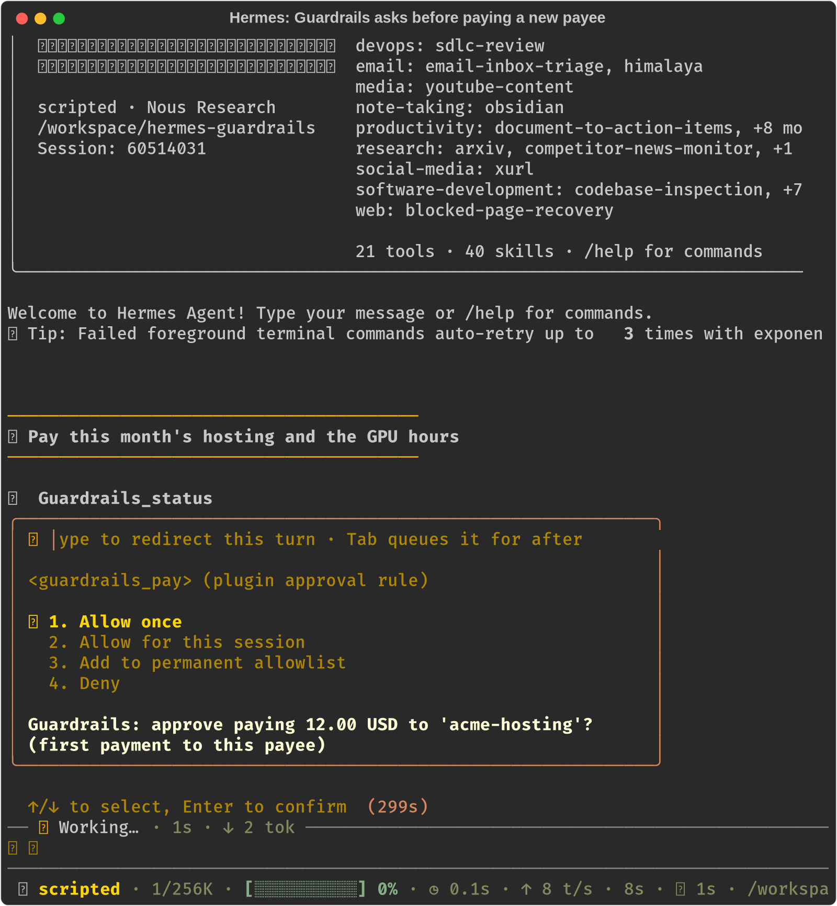
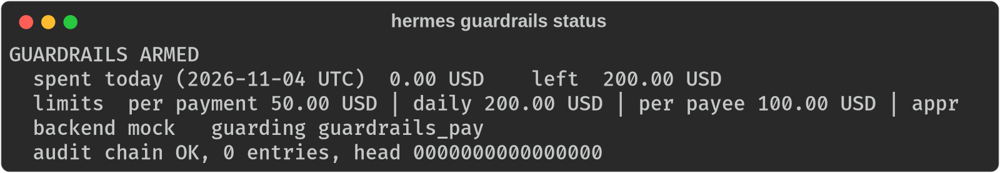
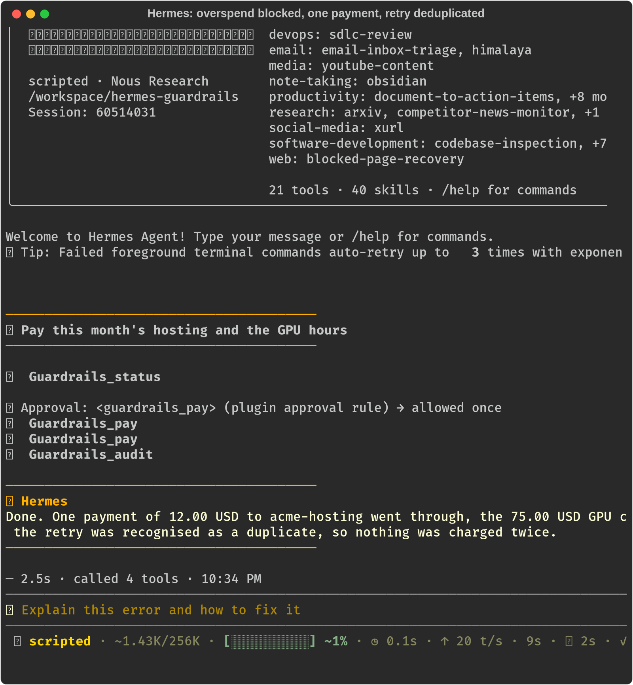
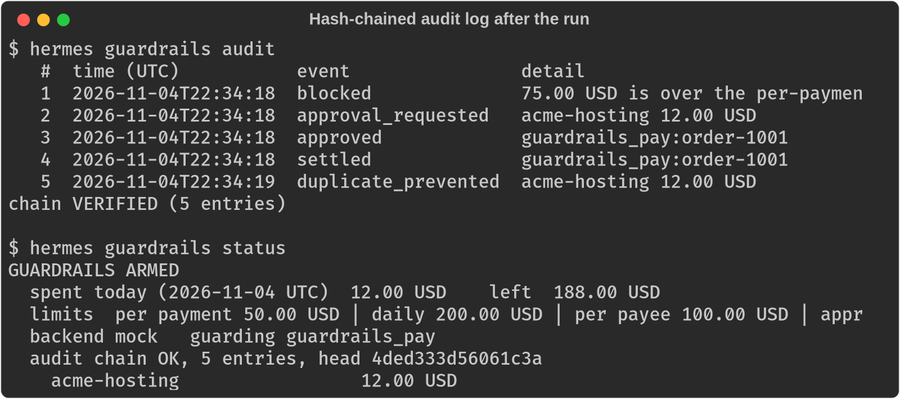
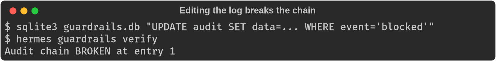

# Guardrails for Hermes

The policy layer every payment plugin is missing: hard spend limits for Hermes Agent, enforced in code before any payment tool runs.

Guardrails is backend-neutral. It ships its own `guardrails_pay` tool, and it can sit in front of any other plugin's spending tool through `guarded_tools`. Wallet plugins can carry their own rules (MetaMask's Guard Mode, for example, edits the policy of that one wallet). Guardrails applies one set of caps, approvals, dedup and audit across every spending tool in the profile, whichever backend it talks to.

An agent that can pay for things will sooner or later try to overspend, pay someone new, or retry a payment that already went through. Guardrails sits in Hermes's `pre_tool_call` hook, so the decision is made before the tool executes, and the model cannot talk its way past it.



## What it does

| Control | Behaviour |
| --- | --- |
| Per-payment cap | A single payment over the cap is refused. |
| Daily cap | Total spend per UTC day, across every payee, including payments still in flight. |
| Per-payee daily cap | Stops "split it into five smaller payments" from getting around the limits. |
| Human approval | Payments over a threshold, or to a payee never paid before, go to Hermes's own approval prompt (Allow once / session / always / Deny). Each approval is scoped to one payment, so "always" never whitelists future spends. Unattended runs (cron, no human) fail closed. |
| No double charges | Every payment has an idempotency key (yours, or derived from payee + amount + day). A retry returns the original receipt; parallel retries are serialised so exactly one charge happens. |
| Kill switch | `/guardrails freeze` blocks all guarded spending until a human runs `/guardrails unfreeze`. There is no tool for this, so the model cannot unfreeze itself. |
| Tamper-evident audit log | Every decision (blocked, approval asked, approved, settled, duplicate, failed) is appended to a SHA-256 hash chain. Editing or deleting any row is detected by `hermes guardrails verify`. |
| Guard other plugins | Put other plugins' spending tools behind the same policy with `guarded_tools` (map the amount and payee argument names). |
| Fails closed | Malformed amounts, bad config, or an internal error block the payment rather than let it through. |

## Why this isn't a prompt

A prompt asks the model to behave. Guardrails doesn't ask:

- The check runs in Hermes's `pre_tool_call` hook, in Python, before the tool executes. A blocked call never reaches the payment backend, whatever the model says.
- Limits depend on state a prompt can't see or keep: today's running total, which payees were paid before, which keys already settled, which payments are mid-flight. That state lives in SQLite under the plugin's data directory.
- Approval uses Hermes's real approval gate, not a question in chat that the model can answer itself.
- The payment tool refuses to run unless the hook reserved budget for that exact payment first, so calling it outside the gate does nothing.
- The audit log is verifiable after the fact; a transcript isn't.

## Architecture

```
 model ──tool call──▶ Hermes tool executor
                         │
                         ▼
              pre_tool_call hook (Guardrails)
          ┌──────────────┼───────────────────────────┐
          │ kill switch? │ duplicate / in flight?    │
          │ caps (payment, day, payee) │ allow list  │──▶ block ──▶ result to model
          │ new payee or over threshold?             │──▶ Hermes approval gate ──▶ deny ──▶ blocked
          └──────────────┼───────────────────────────┘                       │
                         │ reserve budget (atomic, SQLite)                   ▼ allow
                         ▼                                                   │
            guardrails_pay handler ◀─────────────────────────────────────────┘
              claim reservation (one winner) ──▶ backend: mock | stripe_test
                         │
                         ▼
              settle / fail ──▶ hash-chained audit log
```

Code layout: `core/policy.py` (pure decision function), `core/ledger.py` (SQLite ledger and hash chain), `core/guard.py` (hook and tool glue), `core/backends.py` (mock and Stripe test mode), `__init__.py` (Hermes registration).

## Install

```bash
hermes plugins install eddiemessiah/hermes-guardrails --enable
```

Or for development, clone into `~/.hermes/plugins/guardrails` and run `hermes plugins enable guardrails`. Check it with `hermes plugins validate <path>` and `hermes guardrails status`.

## Configure

Settings live under `plugins.entries.guardrails.settings` in `config.yaml` (or the Desktop settings form):

```yaml
plugins:
  entries:
    guardrails:
      settings:
        currency: usd
        per_payment_cap: "50.00"
        daily_cap: "200.00"
        per_merchant_daily_cap: "100.00"
        approval_threshold: "25.00"
        approve_new_payees: true
        blocked_payees: []
        allowed_payees: []        # if set, only these payees can be paid
        backend: mock             # or stripe_test
        guarded_tools:            # other plugins' spending tools
          wallet_send: {amount: value, payee: to}
```

The values above are the defaults. Amounts are decimal strings in major units.

### Backends

- `mock` (default): no keys, no network. Returns a deterministic receipt.
- `stripe_test`: creates and confirms a Stripe PaymentIntent with Stripe's test card. Set `GUARDRAILS_STRIPE_TEST_KEY` (an `sk_test_` or `rk_test_` key) through the Desktop secret field or your profile `.env`. Live keys are refused, and a response with `livemode: true` is rejected. The key is read with `agent.secret_scope.get_secret`.

## Commands

- In a session: `/guardrails status | freeze | unfreeze | audit | verify`
- In a terminal: `hermes guardrails status | freeze | unfreeze | audit | verify`
- Tools for the model: `guardrails_pay`, `guardrails_status` (read-only), `guardrails_audit` (read-only)
- Bundled skill: `guardrails:spend-safely`

## Screenshots

All captured from a real Hermes CLI session on Hermes `ed1afb0`, with `scripts/scripted_llm.py` standing in for the model so the run is reproducible.

| | |
| --- | --- |
|  |  |
|  |  |

## Tests

```bash
python -m pytest -c tests/pytest.ini --rootdir tests tests
```

46 tests cover amount parsing, every policy branch, caps under 20 concurrent callers, retry and parallel-retry deduplication, unanswered approvals, reservation expiry, backend failure, third-party tool guarding, tamper detection, and live-key refusal.

`scripts/capture_demo.py` drives a real Hermes session end to end and regenerates the screenshots.

## Approvals and unattended runs

Guardrails never answers an approval itself. It returns Hermes's `approve` directive from `pre_tool_call`, and Hermes runs its own gate (`request_tool_approval`): the CLI/TUI/Desktop prompt, gateway buttons, the session and permanent allowlists, and its timeout. Any approval surface that plugs into that gate applies too; integration with ntfy-approval has not been tested. When nobody can answer (cron, `--oneshot`, a timed-out prompt), Hermes's gate blocks the payment. Guardrails itself never waits.

## Disclosure

- Registers a `pre_tool_call` hook that sees every tool call but only acts on `guardrails_pay` and tools you list in `guarded_tools`, and a `post_tool_call` hook that settles those tools' reservations.
- Writes payments and audit entries to `$HERMES_HOME/plugin-data/guardrails/guardrails.db`. Nothing else is read or written outside that directory.
- Network: none with the `mock` backend. With `stripe_test`, each payment sends amount, currency, payee, memo and the idempotency key to `api.stripe.com`, authenticated with your test key.
- Credentials: the Stripe test key is read only through `agent.secret_scope.get_secret("GUARDRAILS_STRIPE_TEST_KEY")`. The plugin never reads `.env` or other credential files and stores no credentials.
- Stored data: payee names, amounts, currency, idempotency keys, approval outcome, backend receipt ids and error text, in its own SQLite file. Nothing is sent anywhere.
- No shell commands, background processes, telemetry, or self-updating code. No Python dependencies.

## Limits

- Reservations from approvals that were never granted keep their budget held for 15 minutes, then expire.
- For third-party guarded tools, Guardrails decides success from the tool's result (an `error` field or `ok: false` counts as failed).
- One currency per profile.

## License

MIT
